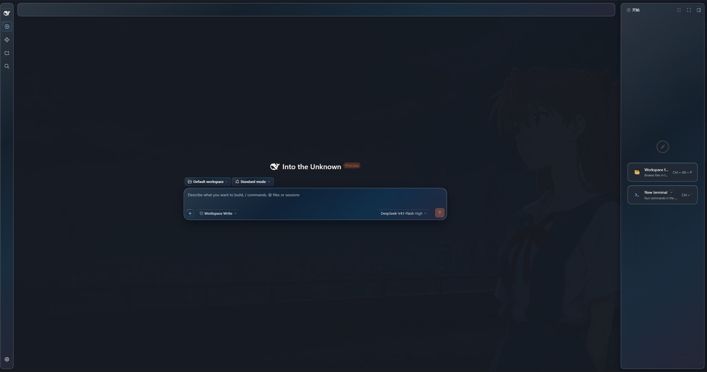

# 主题-明日香 // 02

[English](README.md)

面向 DeepSeek Harness Web UI 的非官方明日香主题插件。插件提供明、暗两套外观、早/午/晚三张右侧人物壁纸，以及与本机时间同步的平滑背景切换。

> 本项目是非官方同人作品，与 DeepSeek、khara、Evangelion 及相关权利方不存在关联。

## 预览



## 兼容性

- DSH：`0.2.0-rc.2`
- Cordis：`4.0.4`
- 开发环境：Node.js `>=20`
- 目标平台：Ubuntu / WSL2 Ubuntu，使用 DSH Web 和 Linux Chrome

`3.2.2` 面向 DSH `0.2.0-rc.2`，已使用 Codex 内置浏览器在隔离的 Windows DSH Web profile 中检查玻璃表面与高透明度壁纸下的显示效果。用户于 2026-10-01 确认当前版本在 WSL Ubuntu 的状态测试与真实模型流式回复均正常。具体核验与边界见 [COMPATIBILITY.md](docs/COMPATIBILITY.md)。

## 安装

### GitHub Release

安装 `3.2.2` Release 中的预构建包：

```bash
dsh plugin --profile web add https://github.com/Yyyyyylor/dsh-asuka-school-theme/releases/download/v3.2.2/dsh-asuka-school-theme-3.2.2.tgz
```

本项目暂未发布到 npm。Release 安装包包含预构建的 Host/Client 代码和三张公开壁纸。安装、更新或移除插件后，请重启 DSH Web profile。

### 从本地项目安装

在项目根目录执行：

```bash
pnpm install
pnpm build
npm pack
dsh plugin --profile web add ./dsh-asuka-school-theme-3.2.2.tgz
```

最后一条命令中的文件名应与 `npm pack` 实际输出的 `.tgz` 一致。

### GitHub 源码标签

从固定的 `v3.2.2` 源码标签安装：

```bash
dsh plugin --profile web add github:Yyyyyylor/dsh-asuka-school-theme#v3.2.2
```

该方式要求主机已安装 Git。请固定到标签而非 `main`，避免后续更新带来不可预期的变动。

## 使用方式

当前未发布的开发版本为输入框、侧栏、顶栏、菜单和 Settings 增加了 Chromium 背景折射、圆角透镜边缘高光和紧凑控件的轻微色散。Settings 使用更强的 48px 背景模糊，同时保留通透底色和边缘高光。窄窗口下，右侧边栏与主内容分配可用宽度，不再自动覆盖主内容，仍可通过按钮手动全屏。鼠标靠近边缘时，高光柔和响应，离开后原地淡出。其他浏览器保留毛玻璃回退；插件与系统的减少动画偏好都会停止跟随指针的高光。这是受 Liquid Glass 启发的网页效果，没有使用 Apple 原生材质。实现与验证边界见 [LIQUID-GLASS.md](docs/LIQUID-GLASS.md)。

窄窗口右栏的全屏按钮图标、悬浮提示和快捷键跟随实际布局；退出全屏后恢复与主内容并排，右栏保持打开。
进入与退出全屏时，右栏与主区域同步过渡；全屏保留单层玻璃边缘，过渡中对话内容不会被挤成竖排。

1. 在 **设置 → 通用 → Theme-Asuka** 中快速切换“关闭 / 上学路上 / 午间教室 / 东京-3 夜”。
2. 在 **设置 → Theme-Asuka** 中调整壁纸时段、透明度、模糊、装饰细节、减少动态效果，并可重置插件设置。
3. 默认“壁纸时段”为自动模式，按本机时间切换：
   - 早：06:00–11:00
   - 午：11:00–17:00
   - 晚：17:00–次日 06:00

新会话页与会话底部输入框使用同一套更轻透的场景化液态玻璃表面，让壁纸保留更多可见细节。会话标题旁的编辑操作可直接修改当前会话名称，无需离开会话页面。

模型回复、思考、工具调用及输出、错误提示沿用消息的玻璃材质，并在壁纸透明度为 100% 时保持清晰可读。

交付文件卡片与模型二级菜单使用一致的圆角玻璃材质；文件操作按钮共用一个外框，并保留原生预览及菜单行为。

输入框的加号菜单保持圆角毛玻璃效果，模糊背后的文字与控件；再次点击加号或工作区选择按钮可关闭对应菜单。加号菜单的底部滚动提示与玻璃边缘高光独立显示。拆分分隔线收在面板上下圆角以内。

菜单打开时保持相同的模糊、色彩与边缘高光，保留折射和指针交互，避免延迟切换材质造成背景闪动。
菜单文字和图标使用 180ms 淡入与 4px 轻微上浮，插件或系统的减少动态效果偏好会禁用此动画。DSH 关闭时立即卸载菜单，没有退出动画阶段，因此关闭仍即时完成。

左侧栏、会话顶部栏与停靠的右侧面板使用统一的悬浮圆角玻璃表面，栏间留白可透出壁纸。保留图标栏、拖拽调整宽度及窄窗口下的原生右栏全屏行为；标题编辑时，空间不足的顶部操作会换行。

右侧栏拆分时，新面板平滑展开；关闭分栏时，剩余面板平滑扩展。桌面窗口进入和退出全屏时，面板宽度平滑过渡。拖拽保持即时响应，插件或系统的减少动画偏好会关闭过渡。

窄分栏的开始页会收起快捷键提示，优先显示入口名称，拉宽后恢复；选中标签的文字与底色统一跟随场景。代码块标题使用独立的场景底色和细分隔线，便于区分标题、代码与回复正文。

自动切换使用交叉淡入效果；启用“减少动态效果”后会关闭该动画。插件不会改写 DSH 官方的浅色、深色或系统外观，只叠加所选的壁纸场景。

壁纸会在解码完成后再开始原有的交叉淡入，并在浏览器空闲时预载可能的下一场景。已解码的预设图片会复用到插件卸载；模糊在各壁纸层淡入前单独处理，避免对持续变化的双层父容器做整屏滤镜。配色变量准备完成后一次应用。透明度和模糊度调节会按动画帧合并预览更新，且不会重复应用无关的主题变量，从而让连续拖动更加流畅。

## 隐私与资源

插件不收集凭据、遥测或浏览器 `localStorage` 数据。标量偏好存储在 DSH 插件 entry `asuka-school-theme` 的 live Config 表单中；DSH 会把旧设置文档迁移到 profile，入口 ID 和偏好字段不变。

公开壁纸位于 `assets/public/`；相关使用说明见 [assets/LICENSE.md](assets/LICENSE.md) 与 [docs/ASSETS.md](docs/ASSETS.md)。请勿将私有开发素材放入发布包。

Host 只读取包内三张壁纸，通过现有 DSH Web server 提供固定 GET/HEAD 路由。浏览器通过 DSH 同源传输访问图片、设置和用户主动编辑的会话标题；不连接第三方服务、不上传数据、不收集遥测、不读取凭据、不启动子进程。运行依赖锁定为 Schemastery `3.18.4`，DSH/Cordis 由宿主提供为 optional peers，不另装运行组件；没有安装期生命周期脚本。依赖、权限与失败边界见[商店审查说明](STORE-REVIEW.md)。独立供应链审查和商店自动复检仍待完成，声明完整不保证自动获批。

## 开发与验证

维护者请先阅读[项目索引](docs/README.md)与[项目专属 AGENTS.md](AGENTS.md)。

```bash
pnpm build
pnpm test
pnpm check
npm pack --dry-run
```

发布包预构建了 `lib/index.js` 与 `lib/client.js`，最终用户安装插件时不需要执行 postinstall 构建。

更多说明见 [docs/COMPATIBILITY.md](docs/COMPATIBILITY.md) 与 [docs/RESEARCH.md](docs/RESEARCH.md)。
